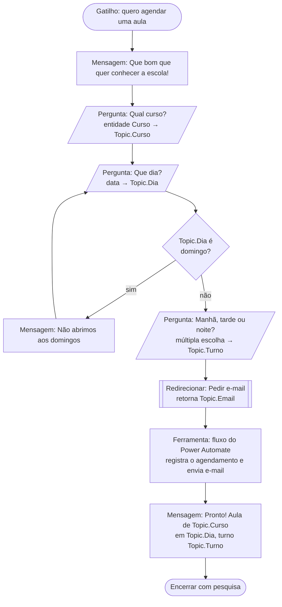

# Fluxo de conversa personalizado no Microsoft Copilot Studio

Resumo do que aprendi no desafio "Criando um Copiloto com Fluxo de Conversa
Personalizado", da [DIO](https://www.dio.me/), a partir da demonstração do
curso e da [documentação oficial](https://learn.microsoft.com/pt-br/microsoft-copilot-studio/).

No [desafio anterior](https://github.com/Ryannzadas/resumo-copilot-studio)
criei o primeiro agente. Neste, o foco é **desenhar a conversa passo a passo**:
o que o agente pergunta, o que guarda, que caminho segue com cada resposta e
como passa a conversa adiante.

> Hoje a Microsoft chama de **agente** o que o curso chama de "copiloto".

## Sumário

1. [A ideia: tópicos como fluxogramas](#1-a-ideia-tópicos-como-fluxogramas)
2. [Criando um tópico](#2-criando-um-tópico)
3. [Nó Mensagem](#3-nó-mensagem)
4. [Nó Pergunta](#4-nó-pergunta)
5. [Entidades: o que o agente reconhece](#5-entidades-o-que-o-agente-reconhece)
6. [Variáveis](#6-variáveis)
7. [Condições](#7-condições)
8. [Cartão adaptável](#8-cartão-adaptável)
9. [Redirecionar e encerrar](#9-redirecionar-e-encerrar)
10. [Power Fx](#10-power-fx)
11. [Editor de código (YAML)](#11-editor-de-código-yaml)
12. [Exemplo completo: agendar aula experimental](#12-exemplo-completo-agendar-aula-experimental)
13. [O que levo deste conteúdo](#13-o-que-levo-deste-conteúdo)

---

## 1. A ideia: tópicos como fluxogramas

Um **tópico** é uma parte da conversa com começo, meio e fim, como "agendar
aula" ou "consultar pedido". No editor do Copilot Studio ele aparece como um
**fluxograma**:

- o **gatilho** decide quando o tópico começa;
- os **nós** são os passos: mandar mensagem, perguntar, testar uma condição,
  chamar uma ferramenta, ir para outro tópico;
- as **variáveis** guardam o que o usuário respondeu e circulam entre os nós.

Há dois tipos de tópico: os **de sistema**, que já vêm prontos (boas-vindas,
"não entendi", escalonar...) e só podem ser desativados, e os
**personalizados**, criados por mim.

## 2. Criando um tópico

1. **Tópicos** → **Adicionar um tópico** → **Em branco**.
2. No nó **Gatilho**, em **...** → **Propriedades**, cadastrar as **frases de
   gatilho**. A recomendação é ter de 5 a 10 frases curtas e variadas. Também
   dá para importar frases de um arquivo de até 3 MB.
3. Em **Detalhes**, preencher nome, nome de exibição e **descrição**.
4. Montar o fluxo com **Adicionar nó** (o botão **+** entre os nós):
   *Fazer uma pergunta*, *Adicionar uma condição*, *Chamar uma ferramenta*,
   *Mostrar uma mensagem*, *Redirecionar para outro tópico*, *Encerrar a conversa*.
5. **Salvar** e testar no painel lateral.

Dicas:
- Com **orquestração generativa** (o padrão atual), o agente escolhe o tópico
  pela **descrição**. Com a **clássica**, pelas **frases de gatilho**. Vale
  caprichar nas duas.
- Não usar ponto (`.`) no nome do tópico, porque isso impede exportar a solução.
- Nós podem ser renomeados (**...** → **Renomear**), o que deixa fluxos grandes
  muito mais fáceis de ler.

## 3. Nó Mensagem

Envia algo ao usuário. Além de texto com formatação, aceita:

| Recurso | Para que serve |
|---------|----------------|
| **Variáveis** (`{x}`) | Personalizar o texto, como "Olá, {Topic.Nome}!". |
| **Variações** | Várias versões da mesma mensagem. O agente sorteia uma a cada vez, o que deixa a conversa menos robótica. |
| **Imagem / vídeo** | URL hospedada (vídeo em MP4 público ou YouTube). |
| **Cartão básico** | Título, texto, imagem e botões. Vários cartões aparecem em carrossel ou em lista. |
| **Respostas rápidas** | Botões de sugestão: enviar uma mensagem, abrir URL (`https://`), ligar ou enviar uma mensagem oculta ao agente. |
| **Fala** | Texto próprio para agentes de voz, com SSML. |

Nem todo canal mostra respostas rápidas, e alguns limitam a quantidade.

## 4. Nó Pergunta

É o coração do fluxo: pergunta e **guarda a resposta numa variável**.

- **Identificar:** define o que espera receber, como múltipla escolha
  (cada opção vira um botão, mas o usuário também pode digitar), número, data,
  e-mail, cidade ou uma entidade personalizada.
- **Salvar resposta do usuário como:** a variável que recebe o valor.

Em **...** → **Propriedades**, há opções importantes:

| Opção | O que controla |
|-------|----------------|
| **Ignorar pergunta** | *Permitir que a pergunta seja ignorada* (se a variável já tem valor, por exemplo porque o usuário já disse antes) ou *Perguntar sempre*. |
| **Solicitar novamente** | Quantas vezes repete se a resposta não for válida: até 2 vezes (padrão), uma vez ou nenhuma. |
| **Nenhuma entidade válida encontrada** | O que fazer depois das tentativas: escalonar (padrão), usar um valor padrão, deixar vazio ou ir para outro tópico. |
| **Validação adicional** | Uma fórmula Power Fx que precisa ser verdadeira, como `Topic.Idade >= 18`, com mensagem própria. |
| **Interrupções** | Se o usuário pode mudar de assunto no meio da pergunta (para qualquer tópico ou só para alguns). |

## 5. Entidades: o que o agente reconhece

**Entidade** é um tipo de informação que o agente sabe extrair da frase do
usuário.

- **Predefinidas:** número, data e hora, dinheiro, e-mail, cidade e outras.
  Por exemplo, "1000 dólares" vira o número 1000.
- **Lista fechada:** criada em **Configurações** → **Entidades** → **Adicionar
  uma entidade** → **Lista fechada**. Cada item pode ter **sinônimos**, e a
  **correspondência inteligente** tolera erros de digitação. Exemplo: o item
  "Inglês" com os sinônimos "english" e "ingles".
- **Expressão regular (regex):** para formatos fixos, como CPF, placa ou
  código de pedido. Diferencia maiúsculas de minúsculas, a menos que se use `(?i)`.
- **Lista de uma variável:** opções que só existem durante a conversa, vindas
  de uma tabela com até 100 itens.

**Preenchimento proativo de slots:** se o usuário escreve "quero agendar
inglês para sábado", o agente já preenche *curso* e *dia* e **pula essas
perguntas**. Isso deixa a conversa natural sem eu precisar programar cada
combinação.

## 6. Variáveis

| Escopo | Onde vale |
|--------|-----------|
| **Tópico** (`Topic.`) | Só no tópico em que foi criada. É o padrão. |
| **Global** (`Global.`) | Em todos os tópicos da conversa. |
| **Sistema** (`System.`) | Criadas pelo Copilot Studio, como `System.Activity.Text` (o que o usuário digitou) e `System.Conversation.Id`. |
| **Ambiente** (`Environment.`) | Configuradas no Power Platform e somente leitura, como URLs e chaves (que podem vir do Azure Key Vault). |

Pontos que aprendi:
- Qualquer nó que produz saída cria uma variável. Para criar ou alterar uma à
  mão, uso o nó **Definir valor da variável**.
- O **tipo** (texto, número, booleano, data, tabela, registro...) é definido na
  primeira atribuição e não muda mais.
- **Passar dados entre tópicos:** no tópico de destino, marco *Receber valores
  de outros tópicos* na variável. No redirecionamento, uso **Adicionar entrada**.
  Para devolver um resultado, marco *Retornar valores para tópicos originais*.
- O nó **Analisar valor** transforma um texto JSON (como a resposta de uma API)
  num registro com campos.

## 7. Condições

**Adicionar nó** → **Adicionar uma condição** cria dois ramos: **Condição** e
**Todas as outras condições** (o "senão").

- Monto a condição escolhendo variável, operador e valor, e posso juntar
  várias com **E** / **Ou**.
- Para mais de dois caminhos, adiciono outros ramos de condição. Eles são
  testados **em ordem** e o primeiro verdadeiro é seguido.
- **Todas as outras condições** fica sempre por último.
- Para lógicas mais complexas, **Mudar para a fórmula** permite escrever a
  condição em Power Fx.

## 8. Cartão adaptável

O nó **Perguntar com cartão adaptável** mostra um **formulário** dentro do
chat: campos de texto, datas, listas de opção e botões. É ótimo para coletar
várias informações de uma vez.

- Pode ser montado no designer ou colando o JSON do cartão.
- Precisa ter pelo menos um botão de envio. Para só mostrar informação, usa-se
  o nó Mensagem.
- Os campos viram **variáveis de saída** automaticamente.
- Cuidado com a versão: o Copilot Studio aceita o esquema até a 1.6, mas o
  Teams vai só até a 1.5.

## 9. Redirecionar e encerrar

| Ação | Efeito |
|------|--------|
| **Ir para outro tópico** | Chama outro tópico e, ao terminar, **volta** para onde estava. Permite passar e receber variáveis. Assim reaproveito tópicos como "pedir e-mail" em vários fluxos. |
| **Encerrar o tópico atual** | Sai do tópico e volta para quem o chamou. |
| **Encerrar todos os tópicos** | Encerra tudo; a próxima mensagem começa do zero (as variáveis globais continuam, a menos que eu as limpe antes). |
| **Encerrar com pesquisa** | Termina com a pesquisa de satisfação. |
| **Transferir para agente** | Passa para um atendente humano, se o canal de atendimento estiver configurado. |

Redirecionar para os tópicos de sistema *Fim da conversa*, *Escalonar* ou
*Recomeçar* encerra a conversa inteira.

O **Verificador de tópico** aponta erros (que impedem o agente de funcionar)
e avisos antes de publicar.

## 10. Power Fx

É a linguagem de fórmulas da Power Platform, a mesma do Power Apps. Aparece
em condições, em **Definir valor da variável**, em validações e em cartões.

```text
Upper(Text(Topic.NomeCliente))              // nome em maiúsculas
Topic.DataAula > DateAdd(Now(), 1)          // a aula é depois de amanhã?
IsBlank(Topic.Email)                        // o usuário não informou e-mail?
Concat(Topic.Cursos, Text(Value), ", ")     // junta uma lista em um texto
```

Detalhes: as variáveis levam o prefixo (`Topic.`, `Global.`, `System.`,
`Environment.`) e os números usam ponto decimal e vírgula como separador de
argumentos.

## 11. Editor de código (YAML)

Em **Mais** → **Abrir editor de código**, o tópico aparece em **YAML**. É útil
para revisar, copiar trechos ou versionar. Um nó Pergunta, como na documentação:

```yaml
- kind: Question
  id: eRH3BJ
  alwaysPrompt: false
  variable: init:Topic.State
  prompt: To what state will you be shipping?
  entity: StatePrebuiltEntity
```

A documentação avisa que montar ou colar tópicos complexos inteiros pelo
editor ainda não é totalmente suportado. O caminho principal continua sendo o
editor visual.

## 12. Exemplo completo: agendar aula experimental

Para juntar tudo, desenhei o fluxo de um agente de uma escola de idiomas.

**Tópico:** `Agendar aula experimental`

- **Descrição:** "Agenda uma aula experimental gratuita: pergunta o curso, o
  dia, o turno e o e-mail do aluno."
- **Frases de gatilho:** "quero agendar uma aula", "aula experimental", "aula
  grátis", "quero testar o curso", "marcar aula", "como faço para experimentar".
- **Entidade `Curso`** (lista fechada): Inglês (*english, ingles*),
  Espanhol (*español, espanhol*), Francês (*francais, frances*).



O que cada parte mostra do conteúdo:

| Passo | Conceito |
|-------|----------|
| Pergunta do curso com entidade de lista fechada | Entidades, sinônimos e **preenchimento proativo**: "quero aula de inglês" já pula essa pergunta. |
| Pergunta do dia + condição "domingo?" | Nó Pergunta com entidade predefinida + **Condição** com volta para a pergunta. Também daria para usar a validação adicional com `Weekday(Topic.Dia) <> 1`. |
| Turno em múltipla escolha | Opções que viram botões. |
| Redirecionar para "Pedir e-mail" | **Tópico reaproveitável** com variável de **saída**: o mesmo tópico serve para outros fluxos, como inscrição em newsletter. |
| Ferramenta | Fluxo do Power Automate recebendo as variáveis como **entrada**. |
| Mensagem final | Variáveis dentro do texto e **variações** de mensagem. |
| Encerrar com pesquisa | **Gerenciamento de tópicos** e satisfação no Monitor. |

## 13. O que levo deste conteúdo

- Um bom fluxo começa **no papel**: desenhar o caminho (inclusive os erros)
  antes de abrir o editor evita retrabalho.
- **Entidades bem feitas** (com sinônimos) e o **preenchimento proativo**
  deixam a conversa natural sem multiplicar perguntas.
- **Variáveis com escopo certo** e **tópicos reaproveitáveis** com entrada e
  saída mantêm o agente organizado quando ele cresce.
- **Condições, validações e o "o que fazer se não entender"** são o que
  diferencia um fluxo robusto de um que trava no primeiro erro de digitação.
- Testar cada ramo no painel lateral, e passar o **Verificador de tópico**,
  antes de publicar.

## Referências

- [Documentação do Microsoft Copilot Studio](https://learn.microsoft.com/pt-br/microsoft-copilot-studio/)
- [Criar e editar tópicos](https://learn.microsoft.com/pt-br/microsoft-copilot-studio/authoring-create-edit-topics)
- [Nó Mensagem](https://learn.microsoft.com/pt-br/microsoft-copilot-studio/authoring-send-message)
- [Nó Pergunta](https://learn.microsoft.com/pt-br/microsoft-copilot-studio/authoring-ask-a-question)
- [Entidades e preenchimento de slots](https://learn.microsoft.com/pt-br/microsoft-copilot-studio/advanced-entities-slot-filling)
- [Variáveis](https://learn.microsoft.com/pt-br/microsoft-copilot-studio/authoring-variables)
- [Sobre variáveis](https://learn.microsoft.com/pt-br/microsoft-copilot-studio/authoring-variables-about)
- [Condições](https://learn.microsoft.com/pt-br/microsoft-copilot-studio/authoring-using-conditions)
- [Cartões adaptáveis](https://learn.microsoft.com/pt-br/microsoft-copilot-studio/authoring-ask-with-adaptive-card)
- [Gerenciamento de tópicos](https://learn.microsoft.com/pt-br/microsoft-copilot-studio/authoring-topic-management)
- [Power Fx no Copilot Studio](https://learn.microsoft.com/pt-br/microsoft-copilot-studio/advanced-power-fx)
